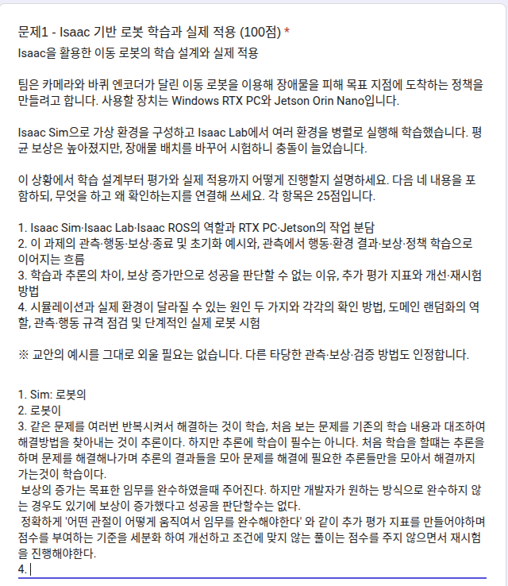

> 작성일 : Oct.20.2026 (Tue)
> 

# 쪽지시험 

# 개인 업무일지 - 2026-10-20 (화)

| 항목 | 내용 |
|---|---|
| 작업 시간 | 10:02 ~ 18:45 (6WD 섀시), 11:23 ~ 15:24 (Isaac 설치 가이드 작성, 강의 실습) |
| 주요 업무 | ① 6WD 섀시 구매 BOM·부품 도감 작성, 설계 확정, 퍽 보관 컵 추가, 출력용 3MF 작성 ② Isaac 설치 가이드 HTML 작성, Isaac Lab Cartpole 강의 실습 |
| 사용 도구 | FreeCAD 1.1.4, Bambu Studio 2.08, Excel(openpyxl), Isaac Lab, Claude Code |

## 1. 요약
- 3D 프린팅이 아닌 구매 부품 34품목을 엑셀 BOM으로 만들고, 부품마다 그림·위치·3D를 볼 수 있는 웹 부품 도감을 만듦.
- 2020 코너 브래킷을 구매품에서 PLA 출력품으로 바꾸고 설계를 확정함.
- 윗판 뒤 조각에 퍽 보관 컵 12개를 2단 계단으로 넣음.
- 공차 시험편은 쓰지 않기로 하고, 출력물 13개를 Bambu Studio 3MF로 만들어 실제 슬라이스로 확인함 (판 7개, 약 29시간, 1835 g).
- 수업 PC 설치 과정을 따라 하기 쉬운 HTML 가이드로 정리하고, 강의에 맞춰 Isaac Lab Cartpole 실습을 진행함.

## 2. TeamRobot 6WD 섀시

### 2.1 구매 부품 BOM (엑셀)
- 파일: `~/Desktop/TeamRobot_6WD_BOM_2026-10-20.xlsx` (원본 `BOM_purchased_parts.csv`).
- 3D 프린팅이 아닌 부품 34품목: 체결 부품·인서트·와셔·T너트, 프로파일, 전자 부품, 배선(TTL 케이블, 허브, USB, 전원), 미정 항목(바퀴 등), 소모품(PLA 필라멘트).
- 시트: BOM(여유분 수식 포함) / 요약 / 모델 대조. 체결 부품 합계 144개.
- 수식 135개 오류 0을 확인함.

### 2.2 부품 도감 (웹 페이지)
- 구매 부품과 출력 부품을 카드로 정리: 부품 그림, 로봇 속 위치 그림, 3D 보기, 규격·수량·체결 정보.
- FreeCAD 모델에서 그림과 3D 메쉬를 자동으로 만드는 스크립트를 작성함 (`make_catalog_assets.py`, `make_catalog_page.py`).

### 2.3 설계 변경과 확정
- 2020 코너 브래킷: 알루미늄 구매품 → **PLA 출력** (두께 5, 다리 30, 옆 보강, 프로파일 홈 키, M5x10 버튼머리 + T너트). 출력 부품 11 → 13개.
- 알루미늄 판과 출력 판 도감을 브라우저에서 비교한 뒤, 출력 판을 **확정판**으로 지정함.
- 공차 시험편이 꼭 필요한지 검토함 → 지금 값으로 출력하고 맞지 않으면 인두기·칼로 다듬기로 결정.

### 2.4 퍽 보관 컵 12개 (윗판 뒤 조각)
- 직접 만든 컵 파일(`Fucking_CUP.FCStd`, 40 x 40 x 40)을 그대로 사용함.
- 배치: 한 줄 6개 x 2줄, 앞 줄은 윗판 위, 뒤 줄은 높이 40 받침 위 (앞 낮게·뒤 높게, 맨 위 Z 169). 윗판 뒤 조각과 한 몸으로 출력.
- 윗판 케이블 장공은 컵 두 줄 사이로 옮김.
- 결과: 윗판 뒤 조각 출력 높이 34 → 89, 무게 +333 g(추정). 뒤쪽 전복각 31.8° → 30.4° (추정, 팔 홈 자세).
- 확인할 점: 컵 안쪽이 아래로 좁아져 바닥이 32 x 32 → 지름 32 이하 퍽만 바닥까지 들어감. 퍽 무게는 아직 미반영.

### 2.5 공차 시험편 삭제, 출력용 3MF 작성
- 공차 시험편 STL·생성 스크립트를 삭제함 (이전 판은 보관 폴더에 있음).
- 출력물 13개를 Bambu Studio 프로젝트 3MF로 만듦: 판마다 1개(7개) + 전체 1개.
  - 설정은 기존 브라켓 3MF의 설정을 그대로 사용: Bambu Lab X2D 0.4 노즐, PLA Matte, 외벽 5, 채움 40%.
- Bambu Studio CLI로 모든 판을 슬라이스해 확인함: 경고 0건, 합계 약 29.1시간, 필라멘트 1835 g.
  - 가장 긴 판은 윗판 뒤 조각 (10시간 55분, 754 g).
- 슬라이스 검사에서 **라이다 브래킷 STL의 출력 방향이 잘못된 것**(플랜지가 맨 위에 떠 있음)을 찾아 뒤집도록 고침.
- PLA 필라멘트 구매 수량을 3롤(1 kg)로 정함 (슬라이스 무게의 1.5배).
- 부품 도감에 출력 부품별 3MF 파일과 출력 시간·무게를 넣어 갱신함.

### 2.6 좌우 벽 확인, 벽 자르기
- 좌우 벽이 거울 대칭이면서 위아래로도 대칭인 것을 확인함 → 같은 부품이라 한 파일을 두 번 출력하면 됨.
- `06_SideWall_R.3mf`를 Bambu Studio 자르기 기능으로 2조각으로 나눔.
  - 자른 위치는 벽 가운데(Y 0 부근)이고, 자른 면은 평면이 아니라 맞물리는 모양임.
  - 두 조각을 판 위에 나란히 놓음. 프린터 설정은 Bambu Lab A1, 0.28 mm Extra Draft.
  - 슬라이스 결과: 경고 없음, 3시간 2분, 171 g.
  - 맞물림 틈과 강도 검토는 진행 중.

### 2.7 검사 결과 (마지막 빌드)
- 간섭 0건, 나사 물림 84건 일치, 여유 공간 89개 비어 있음, 독립 검사 46/46 통과.
- 출력 부품 13개 모두 256 x 256 x 256 안에 들어감.

## 3. Isaac 설치 가이드와 강의 실습

### 3.1 설치 가이드 HTML
- 지금까지의 설치 과정, 생긴 문제 22개, 해결 방법을 처음 보는 사람도 따라 할 수 있는 HTML 가이드로 정리함.
- 단계마다 "이미 있나요?" 확인, 복사 버튼, "이렇게 나오면 성공" 예시를 넣음.
- 원래 가이드와 다르게 동작한 부분(ROS Desktop 설치 불가, 터미널이 닫히는 명령, Isaac Sim–ROS 브리지 실행 방법 등)을 표시함.
- 로컬 사본: `~/pa-course/pa-install-guide.html`.
- `isaaclab` 명령 설명 오류를 바로잡음: `list_envs`만 없고 `train`·`play`·`random_agent`는 가이드대로 동작함.

### 3.2 강의 실습: Isaac Lab Cartpole
- 강의 진행에 맞춰 Cartpole 학습을 6회 실행함 (11:44 ~ 15:24, `~/pa-course/IsaacLab-6.1/logs/rsl_rl/cartpole/`).
  - 환경 1개: 3회 (짧은 시험 포함).
  - 환경 10개, 300회 학습: 3회 완주.
- Isaac Sim이 끊김·강제 종료·오류 없이 동작함. GPU 사용량은 약 4.9 / 8.2 GB.

## 4. 결과물

| 파일 | 내용 |
|---|---|
| `~/Desktop/TeamRobot_6WD_BOM_2026-10-20.xlsx` | 구매 부품 BOM (34품목) |
| 부품 도감 웹 페이지 (`TeamRobot/6WD_Chassis/catalog/`) | 부품별 그림·위치·3D·규격·3MF |
| `TeamRobot/6WD_Chassis/3MF/` | Bambu Studio 3MF 8개, 슬라이스 결과 `slice_report.txt` |
| `TeamRobot/6WD_Chassis/STL/` | 출력용 STL 13개 |
| `TeamRobot/6WD_Chassis/README.md`, `design_review.md` | 확정판 설계·검증 문서 (퍽 컵, 3MF 반영) |
| `TeamRobot/6WD_Chassis/archive_2026-10-19_v8 ~ v10/` | 단계별 이전 판 보관 |
| `~/pa-course/pa-install-guide.html` | 수업 PC 설치 가이드 |

## 5. 다음 할 일
- [ ] 자른 벽 조각의 맞물림·강도 확인 후 출력 방식 결정 (조각 접착 여부 포함).
- [ ] 출력할 프린터 결정 (X2D / A1)과 3MF 설정 통일.
- [ ] 퍽 지름·무게 확인 후 무게중심 다시 계산.
- [ ] 출력 시작, 첫 출력 후 끼움 확인 (칼라·주먹장·인서트).
- [ ] 팀원 D435 브래킷, 바퀴, 배선 결정.
- [ ] Cartpole 학습 결과 정리 (환경 수에 따른 차이).