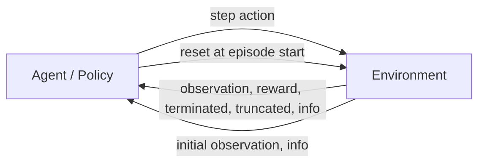

> 작성일 : Oct.23.2026

# 오늘 만드는 것 · 항목별 설명

| 단계 | 직접 작성할 것 | 완료 확인 |
|---|---|---|
| 모델 연결 | 자기 로봇 장면·구동기 | 이름·단위·작동 방향 확인 |
| 과제 설계 | 목표·관측·행동·보상·종료 | 설계표와 수치 사례 |
| 코드 작성 | 환경 함수·로봇 설정 | `check_env`와 물리 검사 |
| 학습 실행 | 실행 설정·로그 | 자기 로봇 `policy.zip` |

## 생소한 이름의 뜻과 분류

- **PPO**는 학습 알고리즘입니다.
- **SB3**와 **RSL-RL**은 알고리즘을 구현한 라이브러리입니다.
- **MuJoCo**는 물리 엔진이고, **Isaac Lab**은 환경을 구성하는 프레임워크입니다.

### 용어 설명

- **PPO (Proximal Policy Optimization)**: 근접 정책 최적화 알고리즘
- **SB3 (Stable-Baselines3)**: 학습 알고리즘 라이브러리, 파이썬에서 강화학습시 사용
- **RSL-RL (Robotic Systems Lab Reinforcement Learning)**: Robotic Systems Lab의 강화학습 라이브러리
- **Gymnasium**: 환경 입출력 규약

## 소프트웨어 계층과 두 실행 경로

파일, 물리 엔진, 환경, 학습기를 구분하면 두 가지 대표 실행 경로를 볼 수 있습니다.

### MuJoCo와 SB3 경로 
> 물리적인 환경만

`내 URDF / MJCF` → `MuJoCo 물리` → `Gymnasium 환경` → `SB3의 PPO`

### Isaac Sim과 RSL-RL 경로
> 미로 안에서 어떤 미션을 수행할건지

`내 USD` → `Isaac Sim PhysX` → `Isaac Lab 태스크` → `RSL-RL의 PPO`

파일은 로봇을 정의하고, 환경은 학습 목표를 정의하며, 학습기는 정책을 갱신합니다. 위 경로는 개념을 설명하기 위한 것으로, 측정된 학습 결과를 나타내지는 않습니다.

## 생소한 이름의 뜻과 분류 · 항목별 설명

| 이름 | 풀어 쓴 뜻 | 무엇을 하는가 |
|---|---|---|
| RL | Reinforcement Learning, 강화학습 | 행동 결과의 보상을 바탕으로 정책을 학습합니다. |
| PPO | Proximal Policy Optimization | 정책을 조금씩 개선하는 학습 알고리즘입니다. |
| RSL-RL | Robotic Systems Lab 계열 RL 라이브러리 | 로봇용 PPO 등의 알고리즘을 실행하는 구현체입니다. |
| SB3 | Stable-Baselines3 | PPO 등을 제공하는 Python 라이브러리입니다. |
| Gymnasium | 환경 인터페이스 라이브러리 | `reset`, `step`과 관측·행동 공간의 규약을 제공합니다. |
| MuJoCo | Multi-Joint dynamics with Contact | 관절과 접촉을 계산하는 물리 엔진입니다. |
| Isaac Sim | NVIDIA 로봇 시뮬레이터 | 장면·물리·센서·렌더링을 실행합니다. |
| Isaac Lab | 로봇 학습 프레임워크 | 태스크와 벡터 환경을 구성하고 학습기와 연결합니다. |

## 로봇 파일이 학습 환경이 되는 구조

- 로봇 자산에 장면과 과제 정의를 추가합니다. 
- 정책은 제공된 관측 배열을 바탕으로 행동을 선택합니다.
- 환경은 물리를 진행하고 보상과 종료 여부를 반환합니다.

### 용어 설명

- **Agent (에이전트)**: 행동하는 학습 주체
- **Environment (환경)**: 행동 결과를 계산하는 환경
- **Observation (옵저베이션)**: 정책에 제공하는 정보
- **Action (액션)**: 정책이 선택하는 제어 명령
- **Reward (리워드)**: 한 스텝의 점수

### 로봇 학습 환경의 데이터 용어

| 단어 | 구체적인 의미 | 예 |
|---|---|---|
| State (상태) | 시뮬레이터 내부의 전체 상태값 | 위치·속도·접촉·물성 |
| Observation (관측) | 정책에 실제로 제공하는 값 | 몸체 속도·관절각·목표 |
| Action (행동) | 정책이 내보내는 제어 명령 | 토크·속도·위치 목표 |
| Reward (보상) | 행동 결과에 매기는 숫자 | 목표 오차가 작을수록 높은 점수 |

### 정책 학습 용어

| 단어 | 구체적인 의미 | 예 |
|---|---|---|
| Policy (정책) | 관측에서 행동을 정하는 함수 | 신경망 `πθ` |
| Episode | 초기화부터 종료까지 한 번의 시행 | 목표 이동 10초 |
| Transition | 한 번의 상호작용 기록 | 관측·행동·보상·다음 관측 |
| Rollout | 여러 transition을 모은 학습 자료 | 환경별 256스텝 |

> 선속도와 각속도를 전체 로봇에 넣었을때 각 바퀴가 어떤속도로 움직이는지를 학습한다.
> 각각의 관절과 링크들에 값을 따로 넣고 학습하는게 아니라 전체가 어떻게 움직이는지를 보고 학습을 시킨다. 
> 성공 실패 기준을 잡는다. 오차별로 점수도 다르게 주어져야한다. 세세하게 설정할것. 만점은 나올수가 없다
> 로봇하나당 하나의 에피소드. 
## 정책과 환경의 데이터 흐름

### Agent–Environment 순환

에피소드 시작 시 `reset()`으로 초기 관측을 받고, 매 행동마다 `step(action)`을 호출해 다음 관측과 보상, 종료 여부를 받습니다. Gymnasium의 `step()` 반환값에는 `terminated`, `truncated`, `info`도 포함됩니다.

### 한 번의 상호작용과 학습 갱신

`관측 o(t)` → `Actor 정책` → `행동 a(t)` → `구동기·물리`

`새 관측·보상` → `경험 저장` → `PPO 업데이트` → `새 정책 가중치`

환경은 행동을 적용해 물리를 진행한 뒤 다음 관측과 보상을 반환합니다. 학습 중에는 이 경험을 저장해 PPO가 정책 가중치를 갱신합니다. 위 흐름은 개념 설명이며, 측정된 학습 결과를 나타내지는 않습니다.

평가 단계에서는 상호작용만 반복하며 정책 가중치는 갱신하지 않습니다.

### 신경망 학습 용어

| 용어 | 뜻 | 코드에서 찾을 곳 |
|---|---|---|
| Parameter (가중치) | 학습 과정에서 바뀌는 신경망 내부의 숫자 | policy 모델 |
| Hyperparameter (하이퍼파라미터) | 학습 전에 사람이 정하는 설정값 | `learning_rate`, `batch_size` |
| Inference (추론) | 현재 가중치로 행동을 계산하는 과정 | `model.predict()` |
| Gradient (그래디언트) | 가중치를 바꿀 때 손실이 얼마나 변하는지 나타내는 값 | 라이브러리의 역전파 |

### 보상·수익·가치·Advantage 용어

| 용어 | 뜻 |
|---|---|
| Reward `r_t` (보상) | 시각 `t`에 받은 한 스텝의 점수 |
| Return `G_t` (수익) | 현재부터 미래까지 받을 보상을 할인해 더한 값 |
| Discount factor `γ` (감마) | 미래 보상의 중요도를 조절하는 할인율 |
| Value `V(o_t)` (가치) | 관측 `o_t`에서 앞으로 얻을 수익에 대한 예측 |
| Advantage `A_t` (이점) | 실제 행동의 결과가 기준 가치 예측보다 얼마나 좋거나 나빴는지 나타내는 값 |
| `Σ` (시그마) | 여러 항을 더한다는 기호 |
| `ε` (엡실론) | PPO에서 정책 업데이트 크기를 제한하는 클리핑 범위에 쓰이는 설정값 |

간단히 표현하면 할인 수익은 `G_t = r_t + γr_{t+1} + γ²r_{t+2} + …`입니다. Advantage는 보통 `A_t ≈ G_t - V(o_t)`처럼 이해할 수 있습니다. 즉, 한 스텝의 보상과 장기적으로 기대되는 수익은 서로 다른 개념입니다.

### 로봇에서 학습할 목표 선택

먼저 자기 로봇이 잘 수행해야 할 **Task(태스크)** 하나를 정합니다. 목표가 분명해야 관측, 행동, 보상, 종료 기준도 일관되게 설계할 수 있습니다.

- **관절 속도 제어**와 **몸체 주행 성능**은 서로 다른 학습 목표이므로 구분해서 다룹니다.
- 예를 들어 관절 속도 추종은 정해진 관절 속도 목표를 따라가는 과제이고, 몸체 주행은 로봇의 선속도·각속도 목표를 따라 이동하는 과제입니다.
- **Slider**와 **CartPole**은 학습 환경과 목표를 익히기 위한 보조 예제이며, 자기 로봇의 과제를 대신하지 않습니다.

### 목표 선택에 쓰이는 용어

| 용어 | 뜻 |
|---|---|
| Task (태스크) | 로봇이 달성해야 하는 과제 |
| Joint (조인트) | 로봇의 두 부분을 연결하며 회전하거나 움직이는 관절 |
| Actuator (액추에이터) | 관절이나 몸체에 힘·토크·목표값을 가하는 구동기 |
| Torque (토크) | 회전시키는 효과를 내는 힘 |
| Tracking (트래킹) | 목표값과 실제값의 차이를 줄이며 목표를 따라가는 제어 |

### 로봇 유형별 시작 과제와 확장

| 로봇 | 시작 과제 | 이후 확장 |
|---|---|---|
| 바퀴 로봇 | 구동 관절 속도 추종 또는 몸체 전진 속도 제어 | 방향 제어와 목표 지점 이동 |
| 로봇팔 | 선택한 관절의 자세 또는 속도 추종 | 끝단 목표 도달과 물체 조작 |
| 다족 로봇 | 안정된 초기 자세 유지 | 균형 잡기와 보행 |
| 복합 로봇 | 하나의 구동부 동작 | 여러 기능을 순차적으로 수행 |

### URDF·USD와 학습 장면 준비

학습 목표를 정한 뒤에는 로봇 모델을 물리 엔진과 환경에서 사용할 수 있도록 준비합니다.

- **URDF**는 로봇의 링크와 관절 구조를 기술합니다.
- **USD**는 시뮬레이션 장면과 자산을 구성하는 형식입니다.
- **MJCF**는 MuJoCo에서 로봇 모델과 물리 설정을 표현하는 형식입니다.
- MuJoCo 학습 장면에는 모델뿐 아니라 구동기(`actuator`), 접촉 설정, 초기 자세도 준비해야 합니다.
- 코드와 설정에서 실제 `joint` 및 `actuator` 이름이 모델과 일치하는지 확인합니다.
- 토크·속도·위치 목표를 사용할 때는 각 값의 단위와 제어 방식이 서로 맞는지 확인합니다.

| 용어 | 뜻 |
|---|---|
| Link (링크) | 로봇을 이루는 강체 부분 |
| Mesh (메시) | 링크의 모양이나 표면을 표현하는 형상 데이터 |
| MJCF | MuJoCo 모델과 시뮬레이션 설정을 표현하는 형식 |
